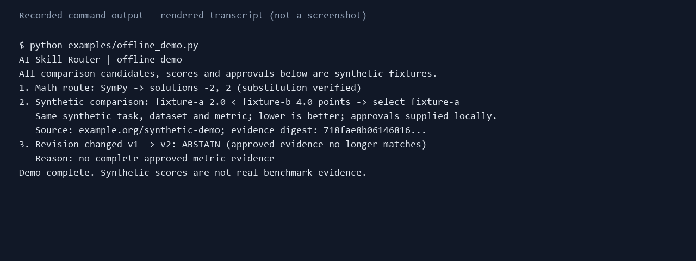
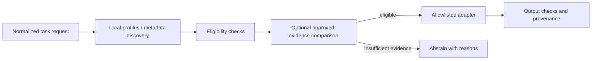

# AI Skill Router

[](https://github.com/xidi0722/ai-skill-router/actions/workflows/ci.yml)

**An early evidence-aware routing prototype for scientific tools, with auditable decisions and abstention.**

[繁體中文](README.zh-TW.md) · [Contributing](CONTRIBUTING.md) · [Report an issue](https://github.com/xidi0722/ai-skill-router/issues)

An agent needs more than a tool name: is the tool executable, does its evidence apply to this task, and does that evidence still match the artifact version? This prototype checks those conditions and can abstain when a required comparison cannot be made.

Use it to inspect eligibility and version-bound evidence before calling a registered scientific tool. A reachable deployment may have evidence for an older revision; requiring comparable approved evidence can make the router abstain. It is not yet suitable for unattended discovery and execution of arbitrary public models.

The offline demo solves `x² − 4 = 0`, compares two **synthetic** candidates, then changes one revision and shows an abstention. The comparison scores and approvals are fixtures, not real model benchmarks.



## Quickstart

Requires Python 3.11+ and pip. From a clone of this repository:

```sh
python -m pip install -e .
python examples/offline_demo.py
```

No API key or network is required to run the demo after installation. Expected results: solutions `-2, 2` verified by substitution; synthetic candidate `fixture-a` selected; then `ABSTAIN` after its revision changes. On Windows, use `py -3` instead of `python` if needed.

## Who is this for?

Run `python examples/python_integration.py` for success, abstain and execution failure; run `python examples/http_integration.py` for a loopback HTTP request. The caller supplies `task_id`, `inputs`, optional `constraints`, and `execute`. Inspect `decision`, `provenance`, and `execution` in the response. The service normally uses HTTP 200 for abstention and adapter failure, so inspect the body. Reconsider input or evidence after abstention; do not blindly retry invalid inputs. Transient provider connection or timeout errors may be retried with a bounded policy. The local example does not call a provider.

Run `python examples/weather_evidence_gap.py` to see a real deployment abstain offline when approved comparable precipitation evidence is missing. See the [source audit](outputs/evidence-source-audit.md): WeatherBench Z500 results do not measure this single-point precipitation service, and model version binding is missing. This example does not ingest those benchmark scores or demonstrate a comparison between them.

Agent developers and scientific-tool integrators exploring explicit eligibility, evidence and failure reasons. Evaluation researchers can inspect the fixture datasets and compare routing policies. The current implementation is a research prototype.

## What works today

- Curated local capability profiles; Hugging Face discovery returns metadata only.
- Allowlisted SymPy equation solver and fixed-host Open-Meteo WeatherNext adapter.
- Optional approved, version-bound evidence comparison with structured abstention.
- Python service, CLI and localhost HTTP API.

The weather service has not been backtested by this project. Public benchmark scores are not bound to its deployment. The local approval ledger is unsigned; SymPy's subprocess timeout is not a complete sandbox. Natural-language task parsing, arbitrary model execution and MCP clients are not implemented. See [implementation status](outputs/implementation-status.md) and [evidence limits](outputs/evidence-routing-evaluation.md).



## More examples and verification

```sh
umr route --request examples/solve.json --execute
python -m pip install -e ".[test]" -c constraints-dev.txt
python -m pytest -q
python tools/run_offline_evaluation.py
python tools/run_evidence_ranking_evaluation.py
```

Both offline evaluation datasets use synthetic fixtures and do not establish real model quality. Weather and Hugging Face commands use external services and are optional; see [architecture](outputs/architecture.md), [research](outputs/research-report.md), [evidence audit](outputs/evidence-source-audit.md), and the [Profile schema](src/umr/schemas/capability-profile.schema.json).

Optional live-service and localhost commands:

```sh
umr discover --task-id vision.image_classification
umr route --request examples/weather.json --execute
umr serve
```

For the weather example, update the target date to the current forecast window and check the provider's terms. The HTTP server listens on localhost; `/health`, `/profiles`, `/schema`, and `/route` are available. Strict numeric comparison uses `require_quality_comparison` and `comparison_metric_id` constraints and can load a separate ledger through `--approval-ledger`; see the [evidence contract](outputs/evidence-routing-evaluation.md).

## Troubleshooting

- `No module named umr`: install with the same Python interpreter used for the demo.
- SymPy timeout or worker failure: use a Python installation with subprocess support.
- Windows `python` opens the Store: install Python or use the `py -3` launcher.

Issues and pull requests are welcome. Read [CONTRIBUTING.md](CONTRIBUTING.md) and [the roadmap](ROADMAP.md) before starting.
