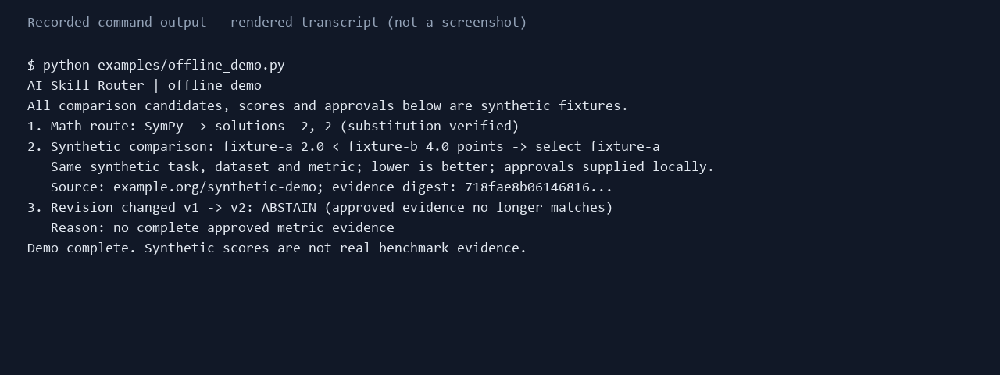

# AI Skill Router

[](https://github.com/xidi0722/ai-skill-router/actions/workflows/ci.yml)

**一個以證據為依據、可稽核路由決策並能拒答的科學工具早期原型。** [English](README.md)

Agent 呼叫工具前，可先檢查它是否可執行、評測證據是否適用，以及證據是否對應目前的資源版本。本專案提供這些檢查及拒答原因。

可用於呼叫已註冊科學工具前檢查資格與版本綁定證據；服務可呼叫但證據屬於舊版時，要求可比較核准證據的政策可選擇 abstain。目前尚不適合無人監督地探索並執行任意公開模型。

離線 Demo 會解出方程式、比較兩個**人工合成**候選，並在版本變動後拒答。分數及核准紀錄均為 fixture，不代表真實模型評測。



## 快速開始

整合範例：`python examples/python_integration.py` 展示成功、abstain、執行失敗；`python examples/http_integration.py` 使用本機 HTTP。呼叫者提供 `task_id`、`inputs`、選用的 `constraints` 和 `execute`；查看回應的 `decision`、`provenance` 與 `execution`。即使 abstain 或 adapter 失敗通常仍為 HTTP 200，必須檢查回應內容。輸入或證據不符應先修正；供應商連線或逾時等暫時故障可考慮有限重試。

`python examples/weather_evidence_gap.py` 展示真實部署缺少已核准可比較降雨證據時離線 abstain。[來源查核](outputs/evidence-source-audit.md)記錄 WeatherBench Z500 指標不適用於該單點降雨服務，且缺少模型版本對應；此範例沒有匯入或比較那些分數。

需要 Python 3.11+ 與 pip，於專案目錄執行：

```sh
python -m pip install -e .
python examples/offline_demo.py
```

安裝完成後，Demo 不需要 API key 或網路。預期看到 -2、2 兩個解經代回驗證；合成候選 fixture-a 被選取；版本變動後輸出 ABSTAIN。Windows 若 python 開啟 Store，可使用 py -3。

## 適合誰使用

適合研究工具資格、證據與失敗原因的 Agent 開發者、科學工具整合者和評測研究者。目前仍是早期研究原型。

## 目前能力及限制

支援本機 Capability Profile、只讀 Hugging Face metadata、受限 SymPy 求解器、固定主機的 Open-Meteo WeatherNext adapter、可選的核准證據比較，以及 Python、CLI 和 localhost HTTP API。沒有自然語言任務解析、任意模型執行或 MCP client。天氣服務未由本專案回測；核准帳本尚未簽章，子程序 timeout 不是完整沙箱。詳見[實作狀態](outputs/implementation-status.md)及[證據限制](outputs/evidence-routing-evaluation.md)。

架構圖、測試指令及故障排除見 [英文 README](README.md)。歡迎閱讀 [繁體中文貢獻指南](CONTRIBUTING.zh-TW.md) 與 [roadmap](ROADMAP.zh-TW.md) 後提交問題或貢獻。

