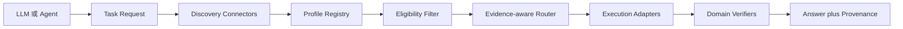

# Universal Model Router：架構與 MVP

## 設計目標

核心作為 LLM/Agent 之外的能力層，提供語言模型無關的 Python SDK 和 HTTP API，MCP 作為可選入口。發現、路由、執行和驗證是分開的元件，以免把「搜尋結果」當成「可執行且適用的模型」。

## 系統流程



### 元件責任

- Task Request：任務 ID、輸入、預期輸出、地區／時間／預算限制。
- Discovery Connector：查詢已設定目錄並回傳來源資料；不執行搜尋到的任意程式碼。
- Profile Registry：保存來源、能力、部署、評測和安全資料。
- Eligibility Filter：先排除輸入、適用範圍、授權、成本或執行條件不符者。
- Evidence-aware Router：只在相同任務和可比較的評測條件內排序；證據不足時降低信心或拒絕。
- Execution Adapter：依固定契約呼叫 API、Gradio、MCP 或本機執行器。
- Domain Verifier：區分格式檢查、領域合理性和經驗品質評估。
- Provenance：記錄資源版本、資料、呼叫時間、成本、驗證器與證據引用。

## Capability Profile v0.1

Profile 分開描述 Model Artifact 和 Deployment。同一個模型可有多個部署；工具或 API 也可具備 Capability，但不冒稱為模型。

```json
{
  "schema_version": "umr/v0.1",
  "id": "urn:umr:example:weather-next-2",
  "kind": "model",
  "source": {
    "publisher": "Google DeepMind",
    "artifact_url": "https://github.com/google-deepmind/weathernext",
    "revision": "recorded-at-ingestion",
    "artifact_digest": null
  },
  "capabilities": [{
    "task_id": "weather.precipitation_forecast",
    "input_schema": {
      "type": "object",
      "required": ["latitude", "longitude", "target_date"]
    },
    "output_schema": {
      "type": "object",
      "required": ["precipitation_sum_mm"]
    },
    "applicability": {
      "geography": "global",
      "max_horizon_days": 14,
      "native_temporal_resolution_hours": 6
    },
    "data_requirements": ["latitude", "longitude", "timezone"]
  }],
  "deployments": [{
    "id": "open-meteo-weathernext2",
    "kind": "hosted_api",
    "endpoint_ref": "fixed-adapter://open-meteo-weathernext2",
    "auth_scopes": [],
    "cost": {"currency": "USD", "amount": null, "status": "must-check-current-terms"}
  }],
  "evaluations": [],
  "quality_evidence_level": "none",
  "trust": {
    "metadata_status": "publisher-and-provider-sourced",
    "execution_status": "adapter-allowlisted"
  }
}
```

評測結果需包含 dataset ID/revision、切分、任務、區域、時距、指標、值、評測日期、來源和證據等級。不同 benchmark 的數值不混成一個總分。

## 領域評估方式

- 天氣：用觀測資料做 rolling-origin 回測，固定預報起報時間、區域、時距和資料版本。連續降水可報 MAE/RMSE；機率或集合預報應報 CRPS、可靠度／校準度，降雨事件可報 Brier score。與持續性、氣候平均或作業預報基準比較，並保留不同地區和時距結果；MVP 尚未具備此回測。
- 數學：對明確的符號方程任務，以固定題集及指定數域做精確解集合等價檢查，再用代回殘差驗證。報告可解題覆蓋率、精確正確率和拒答／超限率；不要拿單題代回檢查推論模型的整體能力。
- 影像：依任務分開使用分類 accuracy／macro-F1、物件偵測 mAP、分割 mIoU／Dice；固定資料集版本、標註政策與資料切分，避免把不同資料集的同名指標直接視為可比。
- 生物結構：按 CASP 等任務資料集、目標蛋白與無資料洩漏切分，使用 GDT_TS、lDDT 或 TM-score 等領域指標；另區分計算結構基準與實驗觀測，不能只憑模型卡摘要宣稱實驗有效。

跨資源路由需先做硬性適用性篩選，再以同任務、同資料集版本、相同切分／區域／預測時距的指標做比較。若不同指標無法校準成有意義的共同效用，保留 Pareto 候選、依明確使用者成本／延遲偏好排序，或 abstain。驗證器分成輸出契約檢查、領域合理性檢查和經驗品質評估；模型自帶 confidence 不能替代外部校準。

## 路由原則

1. 解析成明確 task ID 和正規化輸入。
2. 從設定的目錄搜尋 Profile。
3. 套用任務、輸入欄位、地區、預測範圍、授權、服務狀態與成本硬性條件。
4. 只採用同 task ID 的評測證據；若請求指定 region 或 horizon_days，評測也需涵蓋相同條件（或 region 為 global）。MVP 只接受管理者核准的完整評測紀錄 digest 作為 reproduced／independent 證據，`verified_by` 欄位本身不可信。strict mode 在沒有核准 digest 時 abstain。
5. 比較同一 benchmark、相同版本及相同使用條件的數值；其餘只比較證據等級，不跨指標換算。
6. 選擇候選者並回傳理由、證據缺口和風險。
7. 執行後用格式及領域驗證器檢查，留下 provenance。
8. 無合格候選者或 strict mode 缺少證據時 abstain。

## MVP 範圍

- 資料目錄：本機 curated JSON Profiles。
- 發現連接器：Hugging Face Hub 公開 API，只作 discovery，不把模型卡轉成可執行部署。
- 執行 Adapter：
  - SymPy 方程求解，僅允許受限 AST 運算符，拒絕函式呼叫及任意程式碼。
  - Open-Meteo WeatherNext 2 Ensemble API，固定服務主機，不接受使用者提供 URL。
- 介面：Python SDK、CLI 和只綁定 localhost 的標準庫 HTTP API。
- Profile Schema：JSON Schema 2020-12。
- 品質證據：沒有可比回測結果時仍可在非 strict policy 下提供明確標示為未驗證的預報；strict policy 必須 abstain。
- 現成天氣 API 沒有在 Profile 中固定服務端模型權重 revision；MVP 僅記錄 API/model 標籤和取得時間，無法保證供應商更新前後輸出完全可重現，也未計算集合 spread 或校準度。
- 不在 MVP 執行任意下載的模型權重、Hub repository 程式碼或任意 MCP Server。

## 開發順序

1. Profile JSON Schema、載入器、curated catalog。
2. Task Request、資格篩選、證據等級和 abstain policy。
3. SymPy 安全求解與精確代回檢查。
4. 固定端點的 Open-Meteo adapter 和預報欄位驗證。
5. HF Hub discovery connector，明確標記 metadata-only。
6. CLI 和 localhost HTTP API。
7. 報告路由 provenance、限制與外部 API 條款檢查方式。

## 驗收標準建議

- 以至少 50 條人工標註的任務查詢建立離線路由集；記錄 Recall@5、適用候選 Top-1、abstain precision/recall，並與熱門度和文字相似度基準比較。
- 對缺少必要輸入、任務不符、預測時距超限、不可執行與 strict evidence 缺失案例，確實拒絕路由。
- 每次路由回應均含 profile ID/version、部署 adapter、證據等級、選擇理由和限制。
- Math 結果需能代回原式驗算；天氣結果需驗證座標、日期、timezone、單位與 API 欄位，未回測時明確標記品質未驗證。
- 只有通過同類基準集的路由提升才可宣稱選擇品質提升；成功呼叫 API 不足以證明路由優越。
